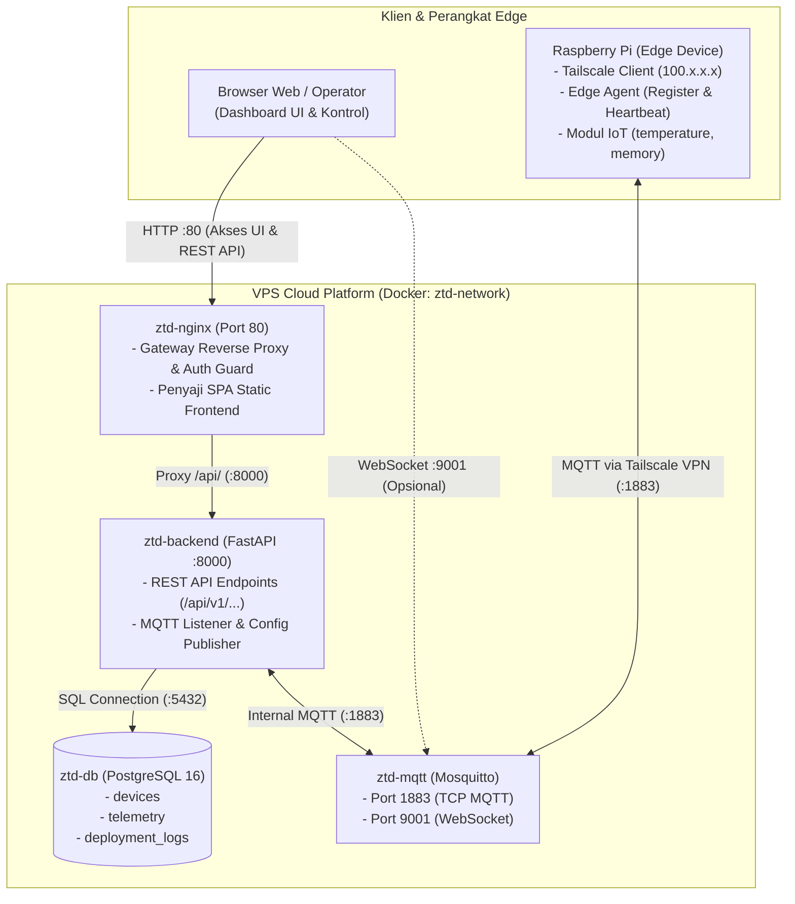

# 🌐 Zero Touch Deployment (ZTD) Cloud Infrastructure & Management Platform

Platform orkestrasi dan infrastruktur cloud terpusat (VPS) untuk manajemen siklus hidup perangkat edge (*edge computing* / Raspberry Pi). Sistem ini mengotomatisasi **auto-discovery** perangkat baru, distribusi konfigurasi modul secara nirkabel berbasis **Desired State**, monitoring performa (*metrics & telemetry*) secara *real-time*, serta pengamanan terpadu melalui gateway Nginx dan broker MQTT.

---

## 🏗️ Arsitektur Sistem



### Peran Komponen Utama:
1. **`ztd-nginx` (Nginx Gateway)**: Reverse proxy di port 80. Mengarahkan traffic `/api/`, menyajikan SPA frontend di `/`, dan melindungi endpoint mutasi (`POST`/`DELETE`) dengan HTTP Basic Auth.
2. **`ztd-backend` (FastAPI)**: Pusat kendali REST API untuk dashboard dan subscriber MQTT persisten internal. Terikat secara aman di `127.0.0.1:8000`.
3. **`ztd-db` (PostgreSQL 16)**: Database relasional persisten (`postgres_data`) yang menyimpan tabel `devices`, `deployment_logs`, dan `telemetry`.
4. **`ztd-mqtt` (Eclipse Mosquitto)**: Broker perantara komunikasi ringan antara server dan armada Raspberry Pi via TCP 1883 dan WebSocket 9001.

---

## 📂 Struktur Direktori Workspace

```text
.
├── apps/
│   ├── api/                   # Backend FastAPI
│   │   ├── src/
│   │   │   ├── routes/        # Router API (/devices, /modules, /bootstrap)
│   │   │   ├── services/      # MQTT Listener, presence tracking, metrics v1
│   │   │   ├── config.py      # Pengaturan aplikasi & environment
│   │   │   ├── database.py    # Koneksi engine SQLAlchemy
│   │   │   ├── models.py      # Model database (Device, Telemetry, DeploymentLog)
│   │   │   ├── schemas.py     # Skema validasi request/response Pydantic
│   │   │   └── main.py        # Entrypoint FastAPI & lifecycle event
│   │   ├── tests/             # Automated unit tests backend (test_device_metrics.py)
│   │   ├── Dockerfile
│   │   └── requirements.txt
│   └── agent/                 # Template/prototype edge agent
├── mosquitto/
│   └── mosquitto.conf         # Konfigurasi listener Mosquitto (1883 TCP & 9001 WS)
├── nginx/
│   ├── default.conf           # Konfigurasi reverse proxy & auth guard
│   └── .htpasswd              # Kredensial basic auth untuk mutasi data
├── postgres/
│   ├── init/
│   │   └── 01-schema.sql      # Inisialisasi skema tabel PostgreSQL
│   └── migrations/
│       └── 002_telemetry_units.sql # Migrasi telemetri contract v2 (temp_unit & schema_version)
├── scripts/                   # Skrip otomatisasi operasional & pengujian
│   ├── simulate_device.py     # Simulator edge device IoT via MQTT (testing live)
│   ├── backup-db.sh           # Dump otomatis PostgreSQL dengan verifikasi & rotasi 7 hari
│   ├── install-backup.sh      # Installer systemd service & timer untuk backup harian
│   ├── harden-nginx.sh        # Skrip setup proteksi Basic Auth Nginx
│   ├── deploy-module.py       # CLI admin untuk memicu deploy modul ke device
│   ├── health-check.sh        # Pemeriksaan kesehatan menyeluruh
│   └── server-status.sh       # Diagnostik CPU, RAM, disk, docker, dan tailscale
├── systemd/
│   ├── ztd-backup.service     # Unit service backup harian
│   └── ztd-backup.timer       # Timer penjadwalan backup otomatis
├── backups/                   # Direktori arsip dump database (.sql)
├── docker-compose.yml         # Orkestrasi 4 kontainer utama
└── README.md                  # Dokumentasi teknis proyek
```

---

## 🚀 Panduan Memulai (Quickstart)

### 1. Konfigurasi Environment (`.env`)
Salin atau buat file `.env` di root direktori:
```env
POSTGRES_DB=ztd_iot
POSTGRES_USER=ztd_admin
POSTGRES_PASSWORD=ganti_dengan_password_aman
POSTGRES_PORT=5432

MQTT_PORT=1883
MQTT_WS_PORT=9001
API_PORT=8000

# Window kehadiran heartbeat (detik)
DEVICE_ONLINE_WINDOW_SECONDS=15
DEVICE_METRICS_STALE_SECONDS=180
```

### 2. Menjalankan Layanan Docker
```bash
# Jalankan seluruh cluster kontainer
docker compose up -d

# Periksa status kesehatan seluruh kontainer
docker compose ps
```

### 3. Verifikasi Kesehatan Sistem
```bash
# Uji endpoint health check via Nginx
curl -s http://localhost/health

# Jalankan skrip diagnostik sistem
./scripts/health-check.sh
```

---

## 📡 Kamus Topik MQTT & Alur Komunikasi

| Topik | Arah | QoS | Fungsi |
| :--- | :---: | :---: | :--- |
| `iot/device/<id>/register` | Edge ➔ VPS | 1 | **Auto-Discovery:** Mendaftarkan perangkat baru ke PostgreSQL secara otomatis. |
| `iot/device/<id>/heartbeat` | Edge ➔ VPS | 1 | Memperbarui timestamp `last_seen` perangkat untuk menjaga status `ONLINE`. |
| `iot/device/<id>/metrics` | Edge ➔ VPS | 1 | **Metrik v1:** Ingestion CPU load, RAM, Uptime, dan IP Tailscale ke JSONB. |
| `iot/device/<id>/config` | VPS ➔ Edge | 1 *(Retained)* | **Desired State:** Mengirim modul yang harus dipasang oleh agen Raspberry Pi. |
| `iot/device/<id>/deployment` | Edge ➔ VPS | 1 | Laporan status eksekusi modul (`installing`, `success`, `failed`, `removed`). |
| `iot/room/<room>/temperature` | Edge ➔ VPS | 0 | Mengirimkan data telemetri pembacaan suhu ruangan/CPU. |

---

## 📋 Dokumentasi REST API

Semua endpoint dapat diuji melalui Swagger UI di: `http://localhost/docs`.

### 1. Health Check
* **Endpoint:** `GET /health`
* **Response:** `{"status": "healthy", "database": "connected"}`

### 2. Ringkasan Metrik Armada (Dashboard Cards)
* **Endpoint:** `GET /api/v1/devices/summary`
* **Response:**
  ```json
  {
    "total_devices": 1,
    "online_devices": 1,
    "offline_devices": 0,
    "rooms_count": 1
  }
  ```

### 3. Inventaris Perangkat (Device Fleet Table)
* **Endpoint:** `GET /api/v1/devices` (opsional: `?room_id=room-b`)
* **Response:**
  ```json
  [
    {
      "id": "raspi-fedae9",
      "hostname": "ztd",
      "room_id": "room-b",
      "ip_address": "100.105.163.126",
      "status": "ONLINE",
      "created_at": "2026-10-01T05:37:31Z",
      "last_seen": "2026-10-29T07:30:00Z",
      "uptime_seconds": 86400,
      "cpu_temp": 42.5,
      "modules": ["temperature", "memory"]
    }
  ]
  ```

### 4. Metrik Sistem Perangkat (Metrics v1)
* **Endpoint:** `GET /api/v1/devices/{device_id}/metrics`
* **Response:** Mengembalikan metrik CPU, utilisasi %, load average, uptime, IP, dan metadata kesegaran data (`available`, `stale`).

### 5. Riwayat Kurva Suhu Telemetri (Line Chart v2)
* **Endpoint:** `GET /api/v1/devices/{device_id}/telemetry?limit=50`
* **Response:**
  ```json
  [
    {
      "timestamp": "2026-10-29T07:20:00Z",
      "cpu_temp": 42.5,
      "unit": "C",
      "unit_source": "reported",
      "schema_version": 2,
      "room_id": "room-b",
      "error": null
    }
  ]
  ```

### 6. Desired-State Modul Deployment *(Dilindungi Basic Auth)*
* **Endpoint:** `POST /api/v1/devices/{device_id}/config`
* **Header:** `Authorization: Basic <credentials>`
* **Payload Request:**
  ```json
  {
    "room_id": "room-b",
    "modules": [
      { "name": "temperature", "version": "1.0.0", "enabled": true },
      { "name": "memory", "version": "1.0.0", "enabled": true }
    ]
  }
  ```

### 7. Hapus Perangkat *(Dilindungi Basic Auth)*
* **Endpoint:** `DELETE /api/v1/devices/{device_id}`
* **Response:** HTTP 204 No Content (menghapus perangkat beserta seluruh relasi log & telemetri secara cascade).

---

## 🛠️ Skrip Operasional & Pengujian (`scripts/`)

Workspace ini dilengkapi perkakas pengujian dan pemeliharaan:

* **Simulasi Edge IoT (Testing Cepat)**:
  ```bash
  # Kirim satu paket lengkap pendaftaran, telemetri suhu, dan metrik
  python3 scripts/simulate_device.py --action all

  # Jalankan loop berkala untuk memantau grafik dashboard secara live
  python3 scripts/simulate_device.py --action loop --interval 10
  ```
* **Pengujian Unit Backend**:
  ```bash
  PYTHONPATH=apps/api python3 -m unittest discover apps/api/tests/
  ```
* **Backup Database Terjadwal**:
  Backup berjalan otomatis setiap hari via `ztd-backup.timer`. Backup manual dapat dijalankan kapan saja:
  ```bash
  ./scripts/backup-db.sh
  ```
* **Diagnostik Server**:
  ```bash
  ./scripts/server-status.sh
  ```
