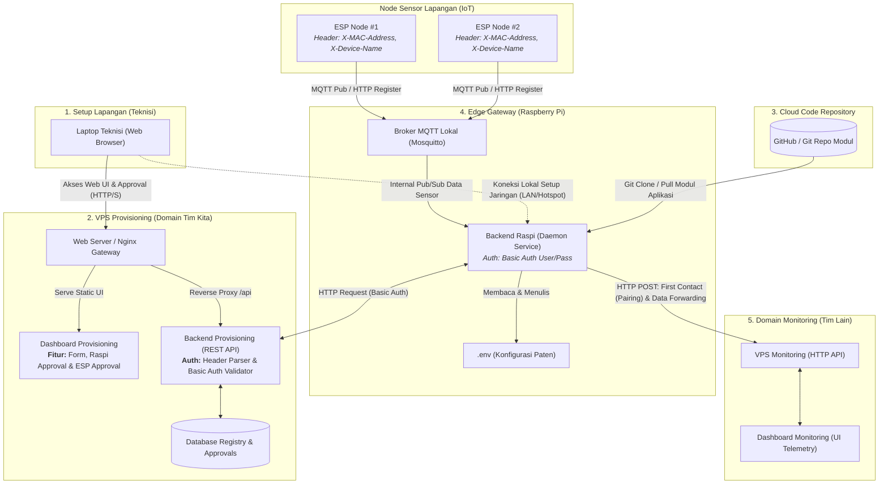
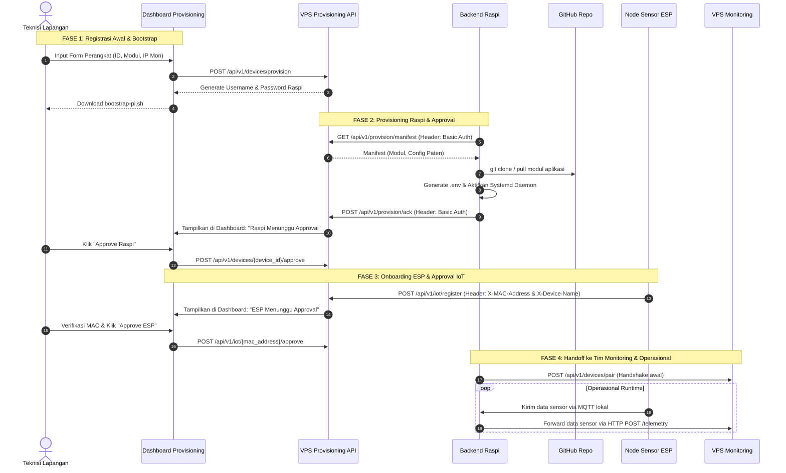

# 📋 Rencana Arsitektur & Implementasi: Sistem Provisioning ZTD

> **Konteks Proyek**: Sistem ini berfokus pada **Domain Provisioning (Inisialisasi & Setup Perangkat Edge)**. Proses operasional lanjutan (monitoring runtime, visualisasi data IoT) diserahkan ke **Tim Monitoring**.
> 
> **Pembaruan Fitur Keamanan**: Sistem menggunakan **Autentikasi Berbasis Header** (HTTP Basic Auth untuk Raspberry Pi, dan `X-MAC-Address` / `X-Device-Name` untuk Node ESP/IoT), serta menerapkan **Fitur Approval Ganda (Dual Approval)** langsung pada **Dashboard Provisioning** baik untuk Raspberry Pi maupun Node ESP sebelum perangkat dinyatakan aktif sepenuhnya.

---

## 1. Ringkasan & Batasan Lingkup Kerja (*Scope Boundary*)

Sistem dibagi menjadi dua domain terpisah dengan kepemilikan tim yang berbeda:

* **Tim Provisioning (Lingkup Kita)**:
  * **VPS Provisioning (Hosting Backend & Dashboard)**:
    * **Dashboard Provisioning (Web UI)**: Antarmuka web yang disajikan oleh VPS Provisioning untuk teknisi melakukan registrasi perangkat, penentuan konfigurasi paten, serta **Approval untuk Raspberry Pi dan Node ESP**.
    * **Backend Provisioning (REST API)**: Layanan API di VPS Provisioning untuk mengelola katalog modul, manifest *desired state*, validasi header kredensial, dan antrean approval.
  * **Edge Gateway (Backend Raspi)**: Layanan latar belakang (*daemon*) pada Raspberry Pi yang mengurus inisialisasi broker MQTT lokal, penarikan modul dari GitHub, pembentukan file `.env`, autentikasi dengan kredensial User/Password ke VPS Provisioning, serta kontak pertama ke VPS Monitoring.
  * **Titik Akhir (*Handoff*)**: Perangkat Raspi dan ESP telah di-approve di Dashboard Provisioning, file `.env` terisi alamat VPS Monitoring, dan Raspi berhasil mengirimkan sinyal siap ke VPS Monitoring.
* **Tim Monitoring (Lingkup Tim Lain)**:
  * **VPS Monitoring**: Backend penerima telemetri runtime via HTTP Request.
  * **Dashboard Monitoring**: Antarmuka visualisasi telemetri dan metrik perangkat.

---

## 2. Diagram Arsitektur Sistem Terpadu



---

## 3. Diagram Alur Kerja (*Sequence Diagram dengan Dual Approval*)



---

## 4. Analisis Peran Komponen di Raspberry Pi

### Mengapa Raspberry Pi Membutuhkan `backend` dan `.env`?

1. **Provisioning Engine & Automation**:
   * Raspi memerlukan *backend agent* untuk menerima konfigurasi jaringan awal dari teknisi, berkomunikasi dengan VPS Provisioning menggunakan kredensial User/Password, menjalankan perintah `git clone`, serta mengonfigurasi *systemd daemon*.
2. **Konfigurasi Paten Berbasis `.env`**:
   * File `.env` menjadi *Single Source of Truth* di tingkat lokal perangkat setelah fase provisioning selesai. Di dalamnya tersimpan parameter permanen seperti `DEVICE_ID`, `MONITORING_VPS_URL`, kredensial `PROVISIONING_PASSWORD`, dan kredensial autentikasi lainnya.
3. **Data Forwarder (MQTT Lokal ➔ HTTP Cloud)**:
   * Broker MQTT lokal (Mosquitto) dipasang di Raspi untuk menerima data berkecepatan tinggi dan hemat daya dari node ESP yang telah terverifikasi.
   * Backend Raspi bertindak sebagai jembatan (*bridge*): men-*subscribe* topik MQTT lokal, memvalidasi payload, lalu meneruskannya (*forwarding*) ke VPS Monitoring via **HTTP Request**.

---

## 5. Rencana File Unit Systemd Daemon (`iot-agent.service`)

```ini
[Unit]
Description=ZTD Edge Gateway Agent & Telemetry Forwarder
After=network-online.target mosquitto.service
Wants=network-online.target mosquitto.service

[Service]
Type=simple
User=pi
WorkingDirectory=/opt/ztd/agent
EnvironmentFile=-/opt/ztd/agent/.env
ExecStart=/opt/ztd/agent/venv/bin/python /opt/ztd/agent/agent.py
Restart=always
RestartSec=5

[Install]
WantedBy=multi-user.target
```
