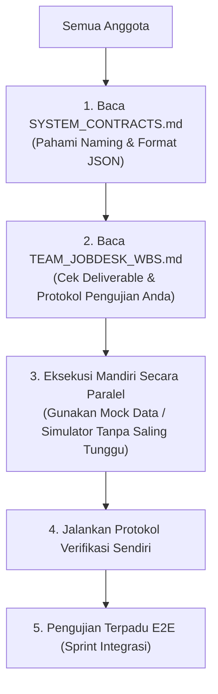

# 📚 Dokumentasi Resmi Sistem Provisioning ZTD

Selamat datang di repositori dokumentasi **Sistem Provisioning ZTD (Zero Touch Deployment)**. Dokumentasi ini menjadi panduan resmi arsitektur, pembagian tugas tim, spesifikasi kontrak data, dan pengujian.

---

## 🗂️ Indeks Dokumen

1. [ARCHITECTURE_PLAN.md](ARCHITECTURE_PLAN.md)
   * Arsitektur menyeluruh sistem provisioning baru.
   * Diagram topologi sistem & batas tanggung jawab (Tim Provisioning vs Tim Monitoring).
   * Alur siklus hidup perangkat dari setup lapangan hingga serah terima (*handoff*).
   * Diagram sequence provisioning step-by-step.

2. [SYSTEM_CONTRACTS.md](SYSTEM_CONTRACTS.md)
   * **Single Source of Truth** untuk seluruh kontrak antarmuka teknis.
   * Standar & konvensi penamaan (Device ID, ESP Node ID, Module Name, Topik MQTT).
   * Katalog 5 Endpoint REST API VPS Provisioning (lengkap dengan skema request & response JSON).
   * Format payload MQTT sensor ESP.
   * Kamus lengkap 10 variabel baku file konfigurasi `.env`.
   * Kontrak handoff HTTP (`/devices/pair` & `/telemetry`) ke VPS Monitoring tim lain.

3. [TEAM_JOBDESK_WBS.md](TEAM_JOBDESK_WBS.md)
   * Panduan pembagian tugas untuk **6 anggota tim** berbasis hasil akhir (*outcome-based*).
   * Bebas memilih metode/tools; fokus pada pencapaian *deliverables*.
   * Kriteria keakuratan (*Definition of Done*) tiap anggota.
   * Protokol pengujian & perintah verifikasi konkret untuk pembuktian hasil.
   * Scorecard serah terima (*Pass/Fail Acceptance Matrix*).

---

## 🚀 Panduan Memulai Kolaborasi Tim (*Quick Start*)

