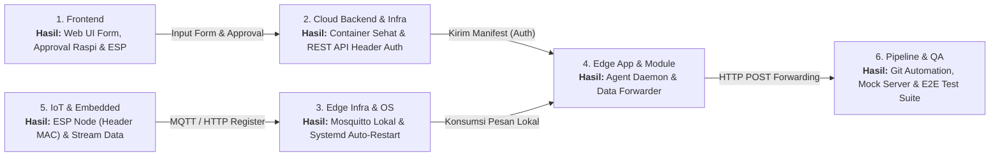

# 🎯 Standar Hasil Akhir & Protokol Verifikasi Keakuratan (Outcome-Based WBS)

> **Prinsip Kerja Tim**: Setiap anggota dibebaskan memilih metode, bahasa, framework, atau *tools* apa pun. Penilaian keberhasilan **murni didasarkan pada Hasil Akhir (*Deliverable Outcome*)** dan pemenuhan **Kriteria Keakuratan (*Acceptance Criteria*)** yang dapat diuji secara objektif melalui **Protokol Verifikasi**.
> 
> Seluruh detail teknis, skema otentikasi header, dan kontrak resmi dapat diakses di:
> 👉 [docs/SYSTEM_CONTRACTS.md](SYSTEM_CONTRACTS.md)

---

## 1. Peta Hasil Akhir & Rantai Aliran Sistem



---

## 2. Rincian Hasil Akhir, Kriteria Keakuratan & Protokol Verifikasi Tiap Anggota

---

### 👤 Anggota 1: Frontend Engineer
* **Filosofi Output**: Bebas menggunakan React, Vue, Svelte, atau HTML/CSS/JS murni. Yang dinilai adalah tampilan web interaktif yang berjalan di browser teknisi.
* **Hasil Akhir (*Deliverable*)**:
  1. Bundle file web antarmuka teknisi yang disajikan oleh Nginx di VPS Provisioning.
  2. Halaman form registrasi perangkat & download script bootstrap.
  3. **Halaman / Tab Approval Ganda**:
     * Antrean Approval Raspberry Pi (tombol "Approve Raspi").
     * Antrean Approval Node ESP/IoT (menampilkan MAC Address & Nama Perangkat dari header, tombol "Approve ESP").
* **Kriteria Keakuratan (*Definition of Done*)**:
  * [ ] Dropdown modul menampilkan data riil dari API katalog modul GitHub.
  * [ ] Tombol *"Download Bootstrap Script"* berhasil mengunduh file `bootstrap-pi.sh` yang valid.
  * [ ] Menampilkan daftar Raspberry Pi yang berstatus `WAITING_APPROVAL` dan tombol aksi untuk approve.
  * [ ] Menampilkan daftar ESP yang berstatus `PENDING` dengan informasi `X-MAC-Address` dan `X-Device-Name`, serta tombol aksi approve.
* **Protokol Verifikasi (Cara Mengetes & Bukti Akurasi)**:
  1. **Uji UI Approval**: Buka browser `http://<IP-VPS>/`, navigasi ke tab Approval.
  2. **Inspeksi Network Tab (F12)**:
     * Saat klik *"Approve Raspi"*: request `POST /api/v1/devices/{id}/approve` terkirim dan status berubah menjadi `APPROVED`.
     * Saat klik *"Approve ESP"*: request `POST /api/v1/iot/{mac}/approve` terkirim dan node ESP masuk daftar aktif.

---

### 👤 Anggota 2: Cloud Infra & Backend Engineer
* **Filosofi Output**: Bebas menggunakan FastAPI, Go, Express, atau framework backend lainnya, serta konfigurasi Docker/Nginx. Yang dinilai adalah stabilitas container cloud dan kepatuhan API.
* **Hasil Akhir (*Deliverable*)**:
  1. `docker-compose.yml` terorkestrasi rapi (Nginx, API Backend, Postgres) yang berjalan *healthy*.
  2. REST API provisioning dengan validasi **Autentikasi Berbasis Header**:
     * HTTP Basic Auth (Username & Password) untuk akses Raspberry Pi.
     * Parser Header `X-MAC-Address` dan `X-Device-Name` untuk pendaftaran Node ESP.
  3. Endpoint Approval untuk Raspberry Pi dan Node ESP.
* **Kriteria Keakuratan (*Definition of Done*)**:
  * [ ] Semua service di `docker compose ps` berstatus `Up (healthy)`.
  * [ ] Endpoint `GET /api/v1/provision/manifest` memvalidasi kredensial Basic Auth Raspi (menolak 401 jika user/pass salah).
  * [ ] Endpoint `POST /api/v1/iot/register` membaca header `X-MAC-Address` & `X-Device-Name` lalu menyimpannya dalam status `PENDING_APPROVAL`.
  * [ ] Endpoint approval (`/devices/{id}/approve` dan `/iot/{mac}/approve`) bekerja dengan benar dan persisten di database PostgreSQL.
* **Protokol Verifikasi (Cara Mengetes & Bukti Akurasi)**:
  ```bash
  # 1. Uji autentikasi Basic Auth Raspi
  curl -i -u "${DEVICE_ID}:${DEVICE_PASSWORD}" "http://localhost/api/v1/provision/manifest?device_id=raspi-plant-01"
  # Response harus 200 OK (jika user/pass salah harus 401 Unauthorized)

  # 2. Uji registrasi ESP dengan Header
  curl -i -X POST http://localhost/api/v1/iot/register \
    -H "X-MAC-Address: 24:6F:28:AB:CD:EF" \
    -H "X-Device-Name: esp32-temp-01" \
    -H "Content-Type: application/json" \
    -d '{"parent_raspi_id": "raspi-plant-01", "sensor_types": ["dht22"]}'
  # Response harus 200 OK dengan status PENDING_APPROVAL
  ```

---

### 👤 Anggota 3: Edge Infra & System OS Specialist
* **Filosofi Output**: Bebas menggunakan skrip bash, Ansible, atau setup manual Raspberry Pi OS. Yang dinilai adalah kestabilan *environment* sistem operasi di Raspi.
* **Hasil Akhir (*Deliverable*)**:
  1. Broker Mosquitto lokal aktif di port `1883` pada Raspberry Pi.
  2. File unit systemd (`iot-agent.service`) yang mengontrol siklus hidup daemon edge.
  3. Struktur direktori `/opt/ztd/` dengan perizinan file `.env` yang aman (`chmod 600`) yang menyimpan kredensial provisioning.
* **Kriteria Keakuratan (*Definition of Done*)**:
  * [ ] Broker Mosquitto running di background, listening di `127.0.0.1:1883` dan IP LAN Raspi.
  * [ ] Service `iot-agent.service` otomatis berjalan saat Raspberry Pi menyala (*enabled on boot*).
  * [ ] **Fitur Self-Healing**: Jika proses agent dimatikan paksa (`kill -9`), systemd otomatis menyalakan kembali proses tersebut dalam waktu <= 5 detik.
  * [ ] File `/opt/ztd/agent/.env` memiliki hak akses ketat `chmod 600` untuk melindungi password provisioning Raspi.
* **Protokol Verifikasi (Cara Mengetes & Bukti Akurasi)**:
  ```bash
  # 1. Uji Mosquitto lokal
  mosquitto_pub -h 127.0.0.1 -p 1883 -t "test/status" -m "OK"

  # 2. Uji Systemd & Self-Healing
  systemctl status iot-agent.service
  sudo kill -9 $(pgrep -f agent.py)
  sleep 6
  systemctl status iot-agent.service   # Status: active (running) dengan PID baru!

  # 3. Uji Hak Akses .env
  ls -l /opt/ztd/agent/.env            # Output wajib: -rw------- (600)
  ```

---

### 👤 Anggota 4: Edge App & Module Engineer
* **Filosofi Output**: Bebas memilih bahasa (Python/Go/Node.js) untuk daemon di Raspi. Yang dinilai adalah fungsionalitas konsumsi MQTT lokal, pengolahan modul, dan pengiriman HTTP ke cloud.
* **Hasil Akhir (*Deliverable*)**:
  1. Program Edge Daemon (`agent.py`) yang menyertakan **HTTP Basic Auth** saat meminta manifest ke VPS Provisioning.
  2. Modul pengolah data sensor (di repo Git) yang siap di-load oleh daemon.
  3. Forwarder HTTP ke VPS Monitoring setelah perangkat berstatus Approved.
* **Kriteria Keakuratan (*Definition of Done*)**:
  * [ ] Program membaca `PROVISIONING_USERNAME` dan `PROVISIONING_PASSWORD` dari file `.env` dan menyematkannya di header `Authorization: Basic ...`.
  * [ ] Berhasil subscribe topik MQTT lokal (`esp/sensors/#`) dan memproses payload sensor.
  * [ ] Meneruskan data via HTTP POST ke VPS Monitoring hanya jika data berasal dari ESP yang valid.
  * [ ] Tahan error (*fault-tolerant*): Jika koneksi gagal, agent tidak crash dan melakukan retry berkala.
* **Protokol Verifikasi (Cara Mengetes & Bukti Akurasi)**:
  1. Tembakkan data sensor ke MQTT lokal:
     ```bash
     mosquitto_pub -t "esp/sensors/temperature" -m '{"node_id":"esp-01","mac_address":"24:6F:28:AB:CD:EF","temp":28.5}'
     ```
  2. Cek log Agent:
     ```bash
     journalctl -u iot-agent.service -n 20 --no-pager
     # Harus ada log: [INFO] Authenticated via Basic Auth & Telemetry forwarded successfully
     ```

---

### 👤 Anggota 5: IoT & Embedded Specialist
* **Filosofi Output**: Bebas menggunakan mikrokontroler fisik (ESP32/ESP8266) dengan Arduino C++ atau MicroPython, ATAU menggunakan skrip simulator Python. Yang dinilai adalah kepatuhan penyematan Header dan kelancaran stream data.
* **Hasil Akhir (*Deliverable*)**:
  1. Firmware ESP yang menginjeksi header `X-MAC-Address` (didapat dari hardware chip `WiFi.macAddress()`) dan `X-Device-Name` saat registrasi.
  2. Skrip simulator berbasis software (`scripts/simulate_esp.py`) yang mendukung pengiriman header registrasi dan stream MQTT.
* **Kriteria Keakuratan (*Definition of Done*)**:
  * [ ] ESP berhasil mengirimkan request registrasi HTTP dengan menyertakan header `X-MAC-Address` dan `X-Device-Name`.
  * [ ] Setelah di-approve, ESP mengirimkan data bacaan sensor ke broker MQTT lokal Raspi secara berkala dengan menyertakan informasi MAC Address.
  * [ ] Fitur *Auto-Reconnect* jika koneksi Wi-Fi atau MQTT terputus sejenak.
* **Protokol Verifikasi (Cara Mengetes & Bukti Akurasi)**:
  ```bash
  # 1. Jalankan simulator ESP dengan mode registrasi header
  python3 scripts/simulate_esp.py --host 127.0.0.1 --mac "24:6F:28:AB:CD:EF" --name "esp32-temp-01"

  # 2. Pantau MQTT di Raspi
  mosquitto_sub -h 127.0.0.1 -t "esp/sensors/#" -v
  # Verifikasi JSON mengandung node_id dan mac_address yang sesuai
  ```

---

### 👤 Anggota 6: DevOps Pipeline & QA Automation Engineer
* **Filosofi Output**: Bebas menggunakan bash, Python test script, atau GitHub Actions. Yang dinilai adalah tersedianya alat uji otomatis (*testing harness*) dan otomasi Git di Raspi.
* **Hasil Akhir (*Deliverable*)**:
  1. Skrip otomasi Git di Raspi (`git-sync` / auto-pull modul dari GitHub ke `/opt/ztd/modules/`).
  2. Mock Server VPS Monitoring (`mock_monitoring_server.py`).
  3. Skrip Pengujian Menyeluruh (*End-to-End Validation Suite*) yang menguji alur **Dual Approval & Header Authentication**.
* **Kriteria Keakuratan (*Definition of Done*)**:
  * [ ] Test Suite E2E menguji skenario autentikasi Basic Auth Raspi (sukses dengan kredensial valid, gagal jika salah).
  * [ ] Test Suite E2E menguji skenario pendaftaran ESP dengan header `X-MAC-Address` dan alur approval-nya.
  * [ ] Seluruh skenario integrasi lolos dengan laporan `PASS` objektif.
* **Protokol Verifikasi (Cara Mengetes & Bukti Akurasi)**:
  ```bash
  # Jalankan Automated E2E Test Suite
  python3 scripts/test_e2e_provisioning.py

  # Kriteria Lolos:
  # ===============================================
  # [PASS] 1. Raspi Basic Auth Validation
  # [PASS] 2. Raspi Provisioning Approval Flow
  # [PASS] 3. ESP Header Registration (X-MAC-Address)
  # [PASS] 4. ESP Provisioning Approval Flow
  # [PASS] 5. Git Clone Modul Berhasil ke /opt/ztd
  # [PASS] 6. HTTP Telemetry Forwarding ke Monitoring
  # RESULT: ALL TESTS PASSED (100% ACCURACY)
  # ===============================================
  ```

---

## 3. Matriks Validasi Keakuratan Akhir (Scorecard Serah Terima)

| Area Tanggung Jawab | Output Nyata | Syarat Lolos (*Pass Condition*) | Verifikator | Status |
| :--- | :--- | :--- | :--- | :---: |
| **Frontend** | Web UI Teknisi | UI Approval Raspi & ESP bekerja, submit & download script lancar | Anggota 1 | [ ] |
| **Cloud Backend** | VPS Provisioning | Basic Auth tervalidasi, Header MAC terbaca, endpoint approval aktif | Anggota 2 | [ ] |
| **Edge Infra** | Lingkungan Raspi | Mosquitto lokal running, file `.env` aman (600), daemon auto-heal | Anggota 3 | [ ] |
| **Edge Module** | Agent Daemon | Request menggunakan Basic Auth & forward data setelah approved | Anggota 4 | [ ] |
| **IoT Sensor** | ESP / Simulator | Request registrasi menyertakan header MAC Address & payload valid | Anggota 5 | [ ] |
| **Pipeline & QA** | E2E Test & Mock | Test suite dual approval & header auth lolos 100% | Anggota 6 | [ ] |
